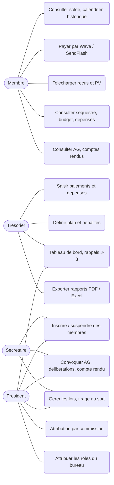
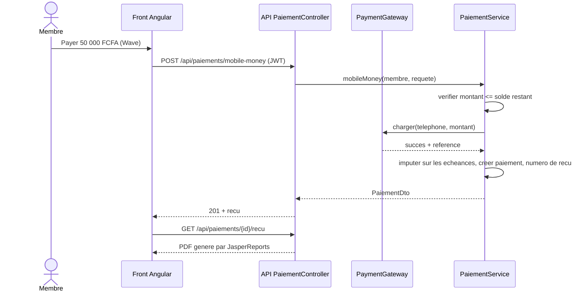
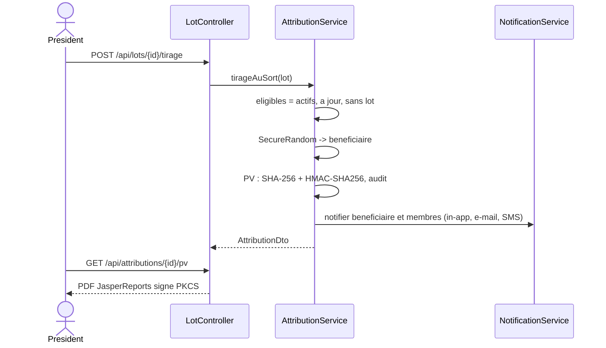
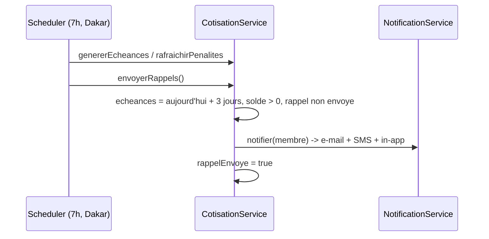

# Diagrammes UML (Mermaid - s'affichent directement sur GitHub / GitLab)

## Cas d'utilisation

## Diagramme de classes

```mermaid
classDiagram
  class Membre{numeroAdherent; nom; email; telephone; typeMembre; statut; role; dateAdhesion}
  class PlanCotisation{montantMensuel; jourEcheance; tauxPenaliteJournalier; penaliteFixe; delaiGraceJours; actif}
  class Cotisation{dateEcheance; montantDu; penalite; montantPaye; rappelEnvoye; getSolde()}
  class Paiement{montant; canal; reference; recuNumero; datePaiement}
  class Lot{reference; typeLot; superficie; latitude; longitude; statut}
  class Attribution{mode; details; dateAttribution; pvNumero; pvHash; pvSignature}
  class Assemblee{titre; dateAssemblee; ordreDuJour; statut; compteRendu; compteRenduPublie}
  class Deliberation{titre; resolution; pour; contre; abstention}
  class BudgetLigne{exercice; categorie; montantPrevu}
  class Depense{dateDepense; categorie; montant}
  class Notification{sujet; message; lu}
  class AuditLog{dateAction; acteur; action; details}
  Membre "1" --> "*" Cotisation
  Membre "1" --> "*" Paiement
  Membre "1" --> "0..1" Attribution : beneficiaire
  Lot "1" --> "0..1" Attribution
  Assemblee "1" --> "*" Deliberation
  Membre "1" --> "*" Notification
  PlanCotisation ..> Cotisation : genere
```

## Sequence : paiement Mobile Money

## Sequence : tirage au sort et PV

## Sequence : rappel J-3

